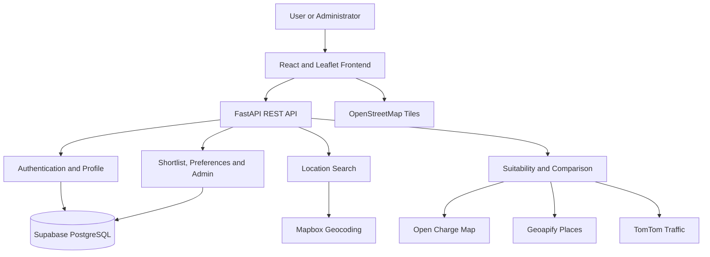

<div align="center">

# ⚡ EV Location Planner

### Plan Smarter. Charge Better.

**A worldwide geospatial decision-support platform for EV charging infrastructure planning.**


[Overview](#overview) · [Features](#features) · [Architecture](#architecture) · [Scoring](#suitability-scoring) · [Setup](#getting-started) · [Team](#team)


</div>

---

## Overview

Choosing where to install an EV charging station requires more than finding an empty location. Existing charging coverage, surrounding commercial activity and road accessibility all influence a site's potential.

EV Location Planner brings these factors together in an interactive application that helps charging companies, city planners, business owners and researchers evaluate candidate sites worldwide. It provides transparent, data-driven planning recommendations rather than booking or navigation services.

## Features

| Feature | What it does |
| --- | --- |
| Interactive map | Explore locations, select custom candidates and visualize reported charging stations. |
| Worldwide search | Find cities, areas and addresses using geocoding. |
| Suitability analysis | Evaluate candidate sites on a 0–100 scale with factor-level insights. |
| Site comparison | Compare up to four candidates and identify the strongest scored option. |
| Saved locations | Shortlist candidates for future planning. |
| Custom preferences | Adjust the relative importance of scoring factors. |
| Personalized dashboard | Access planning tools and account information. |
| Profile management | Update personal information and change passwords. |
| Admin panel | Add, edit and delete administrator-managed station records. |
| Authentication | Protect account-specific operations through JWT and role-based authorization. |

## Architecture



### Technology stack

| Layer | Technology |
| --- | --- |
| Frontend | React, JavaScript, HTML, CSS, Vite |
| Mapping | Leaflet, OpenStreetMap |
| Backend | Python, FastAPI, Pydantic |
| Database | Supabase PostgreSQL, Psycopg; PostGIS enabled |
| Security | JWT, Argon2 password hashing |
| Data processing | Python, Pandas |
| Development | VS Code, Git, GitHub, Swagger UI |

### External data services

| Provider | Purpose |
| --- | --- |
| [Open Charge Map](https://openchargemap.org/) | Reported EV charging infrastructure |
| [Mapbox](https://www.mapbox.com/) | Forward and reverse geocoding |
| [Geoapify](https://www.geoapify.com/) | Nearby commercial facilities and infrastructure |
| [TomTom](https://developer.tomtom.com/) | Road segment and traffic information |
| [OpenStreetMap](https://www.openstreetmap.org/copyright) | Basemap and geographical context |

## Suitability scoring

The planning engine combines three normalized factors using a weighted heuristic.

| Factor | Default weight | Interpretation |
| --- | ---: | --- |
| Charging coverage gap | 40% | Potential opportunity to expand reported charging coverage |
| Commercial facilities | 35% | Presence of nearby businesses and facilities |
| Road proximity | 25% | Proximity to reported road segments and road characteristics |

```text
Suitability = 0.40 × Coverage + 0.35 × Commercial + 0.25 × Road
```

Custom weights can be configured in user preferences. Incomplete required data is reported explicitly instead of fabricating a score.

| Score | Classification |
| --- | --- |
| 80–100 | High suitability |
| 60–<80 | Moderate suitability |
| 40–<60 | Low suitability |
| 0–<40 | Very low suitability |
| Unavailable | Insufficient data |

Scores support preliminary site screening, not guaranteed demand, profitability or installation feasibility.

## Database

| Table | Responsibility |
| --- | --- |
| `planner_users` | Accounts, profile details and roles |
| `planner_shortlist` | User-specific saved candidates |
| `planner_preferences` | Planning preferences and weights |
| `planner_stations` | Administrator-managed station records |

## Repository structure

```text
EV-Charging-Station-Location-Planner/
├── backend/
│   ├── app/
│   │   ├── routers/
│   │   ├── schemas/
│   │   ├── services/
│   │   ├── database.py
│   │   └── main.py
│   ├── scripts/
│   ├── .env.example
│   ├── requirements.txt
│   ├── setup_database.sql
│   └── upgrade_v2.sql
├── frontend/
│   ├── public/
│   ├── src/
│   ├── .env.example
│   ├── package.json
│   └── vite.config.js
├── .gitignore
└── README.md
```

## Getting started

### Prerequisites

Python, Node.js with npm, Git, a PostgreSQL/Supabase database and valid credentials for the external data providers.

### 1. Clone the repository

```bash
git clone https://github.com/TanviGanji18/EV-Charging-Station-Location-Planner.git
cd EV-Charging-Station-Location-Planner
```

### 2. Configure the backend (Windows PowerShell)

```powershell
cd backend
python -m venv venv
.\venv\Scripts\Activate.ps1
python -m pip install -r requirements.txt
Copy-Item .env.example .env
```

Fill in the backend `.env` using your own credentials:

```dotenv
OPEN_CHARGE_MAP_API_KEY=
MAPBOX_ACCESS_TOKEN=
GEOAPIFY_API_KEY=
TOMTOM_API_KEY=
DB_HOST=
DB_PORT=5432
DB_NAME=postgres
DB_USER=
DB_PASSWORD=
JWT_SECRET_KEY=
```

### 3. Initialize the database

Enable PostGIS in the Supabase SQL Editor and run `backend/setup_database.sql`. For an existing V1 database, apply `backend/upgrade_v2.sql` to add the profile fields.

### 4. Start FastAPI

```powershell
uvicorn app.main:app --reload
```

- Backend: http://127.0.0.1:8000
- Swagger documentation: http://127.0.0.1:8000/docs

### 5. Start the frontend

Open another terminal from the repository root:

```powershell
cd frontend
npm ci
Copy-Item .env.example .env
```

Configure the frontend API base URL using the variable specified in its `.env.example`, then run:

```powershell
npm run dev
```

Open the URL printed by Vite. Never expose database credentials, JWT signing secrets or private provider keys in frontend environment variables.

## REST API

| Method | Endpoint | Purpose |
| --- | --- | --- |
| POST | `/api/v1/auth/register` | Register an account |
| POST | `/api/v1/auth/login` | Authenticate |
| GET | `/api/v1/auth/me` | Retrieve account information |
| GET | `/api/v1/locations/search` | Search locations |
| GET | `/api/v1/locations/reverse` | Reverse geocode |
| GET | `/api/v1/stations/nearby` | Retrieve nearby charging stations |
| GET | `/api/v1/infrastructure/summary` | Summarize nearby facilities |
| GET | `/api/v1/traffic` | Retrieve road and traffic data |
| POST | `/api/v1/analysis` | Evaluate a candidate |
| POST | `/api/v1/compare` | Compare candidates |
| GET, POST | `/api/v1/shortlist` | Retrieve or save candidates |
| DELETE | `/api/v1/shortlist/{id}` | Remove a saved candidate |
| GET, PUT | `/api/v1/preferences` | Retrieve or update preferences |
| GET, POST | `/api/v1/admin/stations` | List or add managed stations |
| PUT, DELETE | `/api/v1/admin/stations/{id}` | Update or delete managed stations |

See `/docs` for the complete API contract, including profile operations.

## Security and testing

Authentication uses JWTs and hashed passwords. Administrator access is assigned separately from public registration. Credentials are configured through environment variables and must not be committed to Git.

Development checks include authentication, database connectivity, geographical searches, provider integration, scoring, comparisons, shortlist management, preferences and administrator CRUD operations. Independent integration testing and live deployment verification are release steps.

## Deployment

**Status:** Deployment and live verification pending. The public application URL will be added after deployment.

## Limitations and future scope

- Geographical coverage and response times depend on external providers; reported station status is not guaranteed live availability.
- Scores are heuristic estimates, not validated demand forecasts or investment assessments.
- Charger type is stored as a preference; managed station records remain separate from external provider results.
- Future work includes demand forecasting, automatic candidate generation, electrical grid assessment, land and cost analysis, and performance optimization.

## Team

**Team 18 · Anurag University · B.Tech Project**

| Member | Responsibility |
| --- | --- |
| Ganji Tanvi | Backend, database and frontend integration |
| Nikitha G | Frontend development and UI/UX |
| Akash B | Testing and quality assurance |
| Nehal Maria Choudhary Dhaka | Deployment |

---

<div align="center">

**Plan smarter today for a cleaner mobility future.**

</div>
